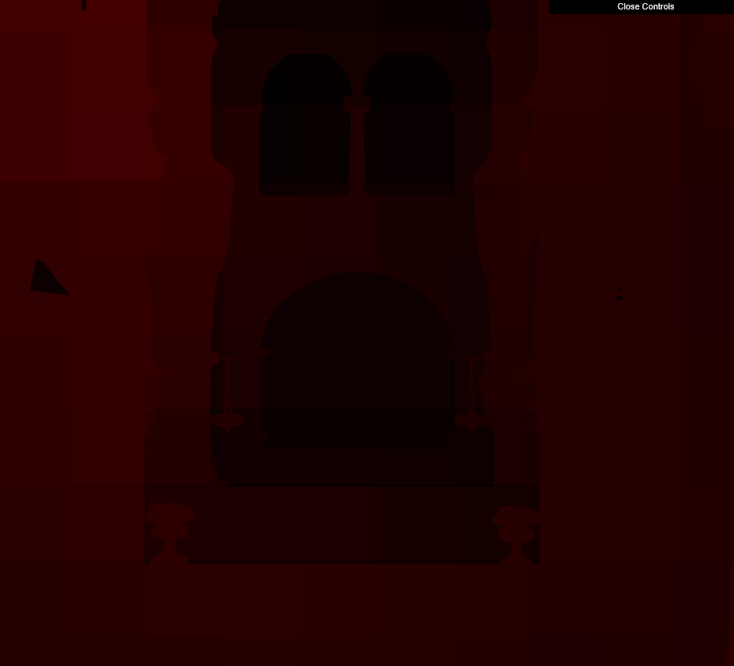

WebGL Forward+ and Clustered Deferred Shading
================

**University of Pennsylvania, CIS 565: GPU Programming and Architecture, Project 4**

* Aidan
* [Personal Website](https://aidanmgideon.com) 
* Tested on: Windows 11, i7-1360P @ 2.20GHz 16GB, RTX 4060 128MB

## Live Demo

### Demo Video/GIF

## Features

This is a WebGPU renderer built in Typescript and WGSL.  It implements Forward, Forward+, and Clustered Deferred rendering.

Forward rendering simply has each fragment iterate through every light in the scene to accumulate its lighting.

Forward+ is like forward, but has a precomputation every frame which splits the camera frustum in 'clusters' and finds out which lights are in which clusters.  Then, when we render a fragment, we iterate through only the lights of the cluster that the fragment's within.

Clustered Deferred is deferred rendering, but we use the same cluster pre-pass as in Forward+.

## Performance Analysis

Generally, naive runs the slowest, Forward+ runs faster than naive, and Clustered Deferred runs the fastest.  Forward+ improves over naive because it prevents each fragment from iterating over tons of lights that don't affect it.  Clustered Deferred improves over Forward+ because it drastically decreases the number of fragments we need to compute lighting for.

However, Forward+ has the overhead of the clustering pre-computation and Clustered Deferred has the overhead of the clustering pre-computation AND deferred rendering itself.  This means that when the fragment computation is really cheap, the overhead of Forward+ is worse than Naive, and gets even worse with Clustered Deferred.  So when there are only a couple lights in the scene, Forward is the best (I think, hard to back up because frametime gets really low).

---

Another factor in the render times is how many clusters we have; how dense is the grid of clusters we slice the frustum into.  I found that a pretty good number for me was linearly slicing 20x20x10 (4000 clusters).  It balances not having too many lights per cluster while not having a ton of clusters to do pre-computation on every frame.  The larger our clusters get, the more lights they will contain.

With very few clusters, we're almost doing Naive so our fragment shading has to iterate through a ton of lights, hurting performance.  With very high clusters, our fragment shader may not have to iterate through a ton of lights, but we have to do a ton of cluster bounding box and light intersection test computations.  There's a balance, as seen in the graph above.

Below is a heatmap visualization of the number of lights inside the fragment's cluster.  With more clusters, we get less lights per cluster increasing fragment shading speed.  But with more clusters, we have more precomputation to do.

|  |  |  |
| --- | --- | --- |
| 10x10x5 (500 clusters) | 20x20x10 (4000 clusters) | 40x40x20 (32000 clusters) |

### Credits

- [Vite](https://vitejs.dev/)
- [loaders.gl](https://loaders.gl/)
- [dat.GUI](https://github.com/dataarts/dat.gui)
- [stats.js](https://github.com/mrdoob/stats.js)
- [wgpu-matrix](https://github.com/greggman/wgpu-matrix)
